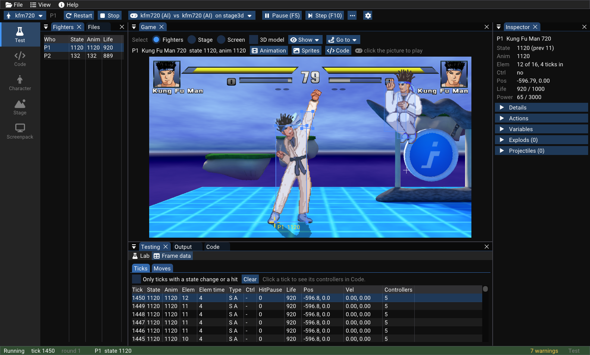
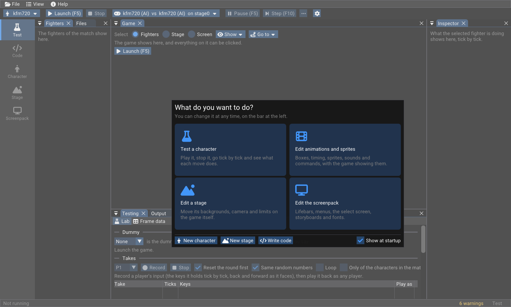
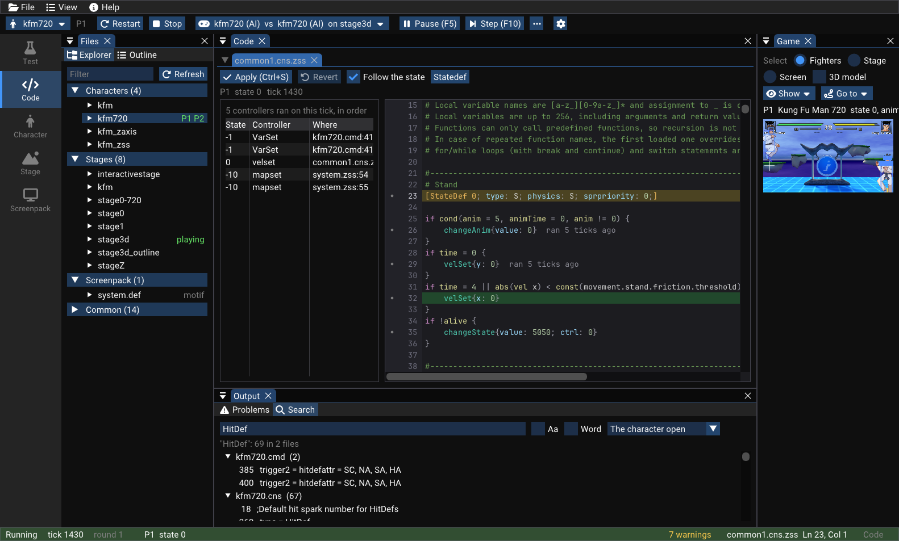
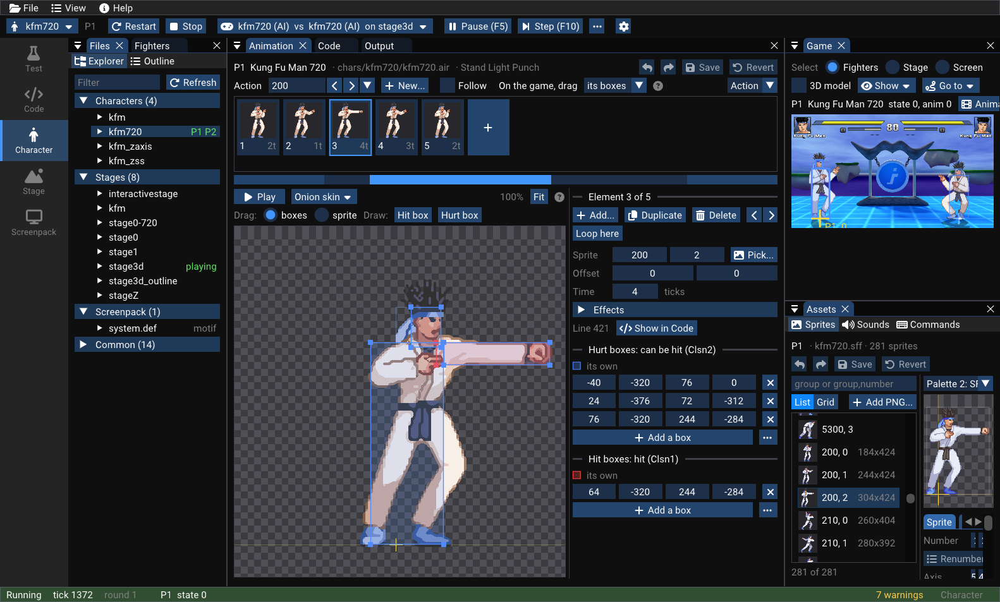
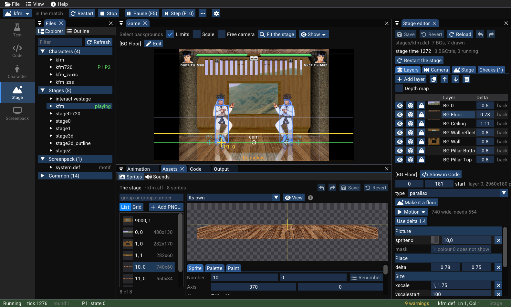
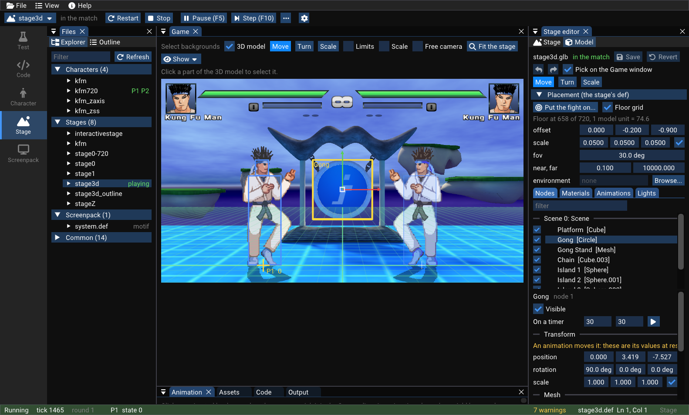
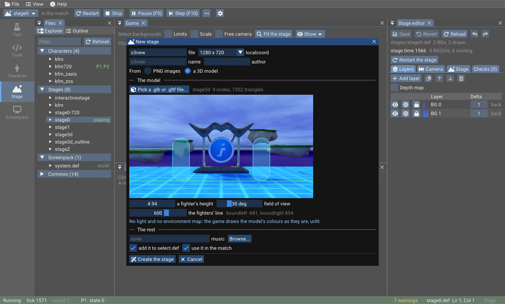
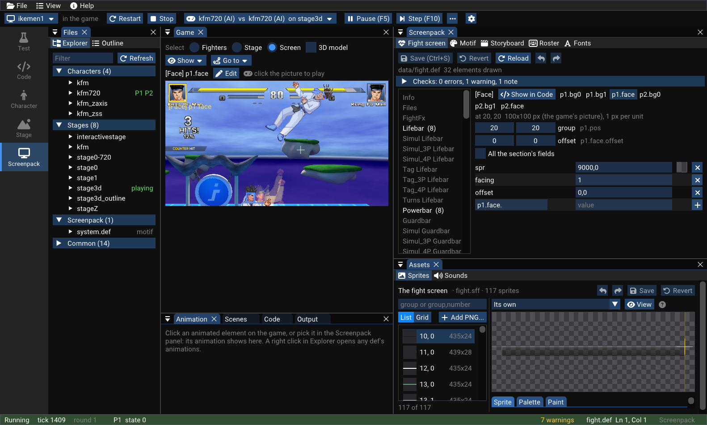

<h1 align="center">Ikemen Studio</h1>

<p align="center">
  <b>A visual editor and debugger for Ikemen GO characters, stages and screenpacks,<br>with the game running inside it.</b>
</p>

<p align="center">
  <a href="https://github.com/zxmarcos/ikemen-studio/releases/latest"></a>
  
  <a href="LICENCE.txt"></a>
  <a href="https://github.com/ikemen-engine/Ikemen-GO"></a>
</p>

<p align="center">
  <a href="#get-started">Get started</a> ·
  <a href="#what-you-can-do">What you can do</a> ·
  <a href="tools/debugger/README.md">Full manual</a> ·
  <a href="#relationship-to-ikemen-go">Relationship to Ikemen GO</a>
</p>



> [!NOTE]
> Ikemen Studio is an independent fork of [Ikemen GO](https://github.com/ikemen-engine/Ikemen-GO), the open source fighting game engine compatible with M.U.G.E.N content. It adds a creator's toolset on top of the engine and is not affiliated with the Ikemen GO team. Please report problems with it [here](https://github.com/zxmarcos/ikemen-studio/issues), not on the Ikemen GO tracker.

## Why

Making content for M.U.G.E.N-style engines usually means text files in one program, sprites in another, and restarting the game to see each change. When a move misbehaves, you are left guessing which line ran.

Ikemen Studio brings that work into one window. The game runs inside the editor, you click what you see on screen to select it, and most changes appear while the match goes on. When something goes wrong, you can stop the game on the exact tick and see the code that ran.

## Get started

1. Download `ikemen-studio-<version>-windows.zip` from the [latest release](https://github.com/zxmarcos/ikemen-studio/releases/latest).
2. Unzip it anywhere.
3. Run `ikemen-debugger.exe` and pick what you want to do.

The package includes the engine, the default screenpack and a sample character, so it works right away. Your own characters and stages go in `chars` and `stages`, as in any Ikemen GO installation.

**Requirements:** Windows 10 (64-bit) and a GPU supporting OpenGL 3.3.

<p align="center">
  
</p>

## What you can do

### Test and debug characters



- **Stop time:** pause, step tick by tick, change the speed, and save or load the match's state.
- **See inside the fight:** state, animation, position, velocity, life, power and variables of every player and helper, with values you can change.
- **Follow the code:** see which state controllers ran on this tick, with their file and line, and how long ago each line of a state last ran.
- **Edit and apply:** a CNS and ZSS editor with syntax colours, an outline, search across files and go to definition, applying changes to the running game.
- **Catch it happening:** breakpoints on a condition or on a state controller, watches, a trace of state changes and hits, and a console for Lua and state controllers.
- **Measure your moves:** frame data with startup, active frames, recovery and advantage.
- **Practise a situation:** a dummy that guards, gets up and answers with recorded input as a reversal.
- **Find problems early:** a check of the character's files for missing states, actions, sounds and commands.

### Animations, sprites and sounds



- **Animate:** a timeline of elements, onion skin, and hit and hurt boxes dragged in the editor or on the game itself.
- **Start from sprites:** make a new action from selected sprites or a whole group.
- **Manage sprites:** SFF v1 and v2, batch operations, palettes and a built-in paint tool.
- **Cut sprite sheets:** mark an area of a sheet and the tool separates each sprite into a new group.
- **Work on sounds and commands:** play and replace sounds, and see the input as the game reads it.
- **Undo anything:** every editor has undo.

### Stages



On the Stage workspace, the game opens directly on your stage and stays there.

- **Edit on the game:** click a background to select it and drag it into place. Hide a layer, show it alone or lock it.
- **Understand the parallax:** sweep the camera between its limits, drag the limits, and see the layers by depth.
- **Avoid holes:** what shows nothing at a camera position is marked on the game, and the tool works out the `delta` that keeps a layer on screen.
- **Build faster:** turn a stack of PNG files into layers, set up a perspective floor, and add motion such as drift, bob, sway or blink in one click.
- **Keep it right:** layer fields follow the layer's type, and checks point out missing sprites, seams in tiles and fighters starting outside the camera.

### 3D stages



- **Create from a model:** File > New > A stage turns a `.glb` or `.gltf` into a working stage. It finds the floor, shows the game's camera with the fighters to scale, and writes everything the stage needs.
- **Edit the model live:** nodes, materials, animations and lights, with handles to move, turn and scale on the game.
- **Place the fight:** click a surface and the fighters stand on it, with a grid showing their floor.
- **Light it:** add suns, lamps and spots, adjust their shadows, and pick an `.hdr` environment map.
- **Bring it to life:** put a node or an animation on a timer.
- **Know before you play:** checks find textures the game cannot read, nodes it would misplace and gaps in the floor, and the game shows anything left uncovered at each camera limit.

<p align="center">
  
</p>

### Screenpacks



- **Click to edit:** select a lifebar, a text or a menu item on the game, then drag it into place.
- **Cover the whole game:** the fight screen, the motif's screens and menus, storyboards, the roster and fonts.
- **Stay safe:** copy a screenpack to a new one before changing it.

### Start something new, then share it

- **New move:** an attack's state, its command and its hit, written into the character's files.
- **New character:** from another one's basics, or as a full copy.
- **New stage:** from PNG images or a 3D model.
- **Package:** make a zip of a project with every file it needs.

See the [full manual](tools/debugger/README.md) for every window and shortcut.

## How it works

Ikemen Studio is a separate program that starts the engine, shows its frames inside its own window and talks to it through a small Lua mod and a set of additions to the engine. Those additions stay off unless the game is started by the studio, so normal play is not affected.

The screenshots use the sample character and stages that come with Ikemen GO. The 3D stage is *Third Heights* by SuperFromND.

## Relationship to Ikemen GO

This repository is a fork of [ikemen-engine/Ikemen-GO](https://github.com/ikemen-engine/Ikemen-GO). All of the engine is the work of its authors and contributors, and it is regularly merged in from upstream.

This fork adds:

- the studio itself, in [`tools/debugger`](tools/debugger);
- the engine side of it, kept in `src/script_debugger.go` and `src/editor_*.go`, with small hooks elsewhere;
- its own Windows packaging, in [`.github/workflows/build.yml`](.github/workflows/build.yml).

For the engine's features, other platforms and community resources, see the [Ikemen GO project](https://github.com/ikemen-engine/Ikemen-GO) and its [wiki](https://github.com/ikemen-engine/Ikemen-GO/wiki).

## Build from source

Set up MSYS2 UCRT64 as described in [BUILDING.md](BUILDING.md), then add CMake and Ninja. [`tools/debugger/scripts/msys_setup.ps1`](tools/debugger/scripts/msys_setup.ps1) installs everything into a fresh MSYS2. With `MSYS2_ROOT` pointing at it:

```powershell
tools\debugger\scripts\build.ps1            # the engine and the studio
tools\debugger\scripts\build.ps1 debugger   # only the studio
tools\debugger\scripts\build.ps1 test       # the unit tests
```

The game also needs `chars`, `stages`, `data`, `font`, `sound` and `video` from an Ikemen GO release next to `Ikemen_GO.exe`. The [manual](tools/debugger/README.md#build) has the details, and [NOTES.md](tools/debugger/NOTES.md) describes how the code is organized.

## License

The Ikemen GO engine and this fork are under the MIT License, and the bundled screenpack assets are under Creative Commons licenses. See [LICENCE.txt](LICENCE.txt) for details. Each package also has a `LICENSES.txt` covering everything it includes.

The Windows package dynamically links FFmpeg (LGPL v2.1). The exact corresponding source for that build is provided on each [release page](https://github.com/zxmarcos/ikemen-studio/releases/latest) as `src_ffmpeg.tar.gz`, and you may rebuild this application against a modified FFmpeg.
